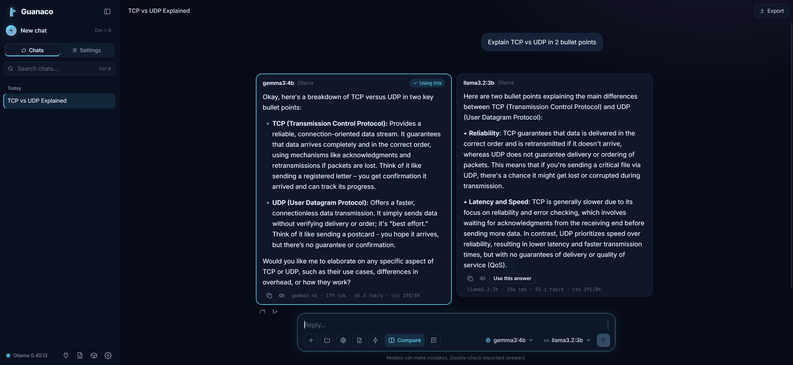
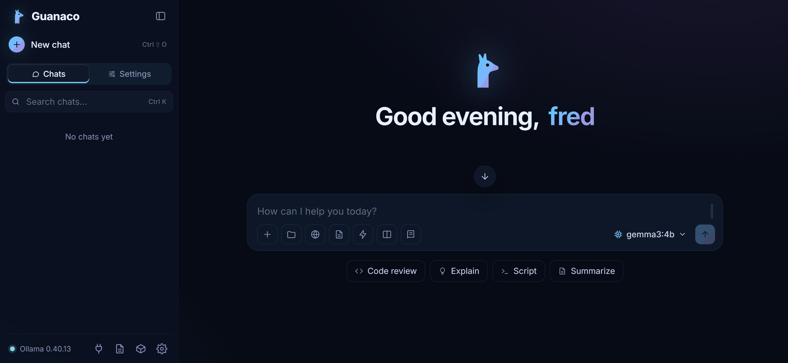
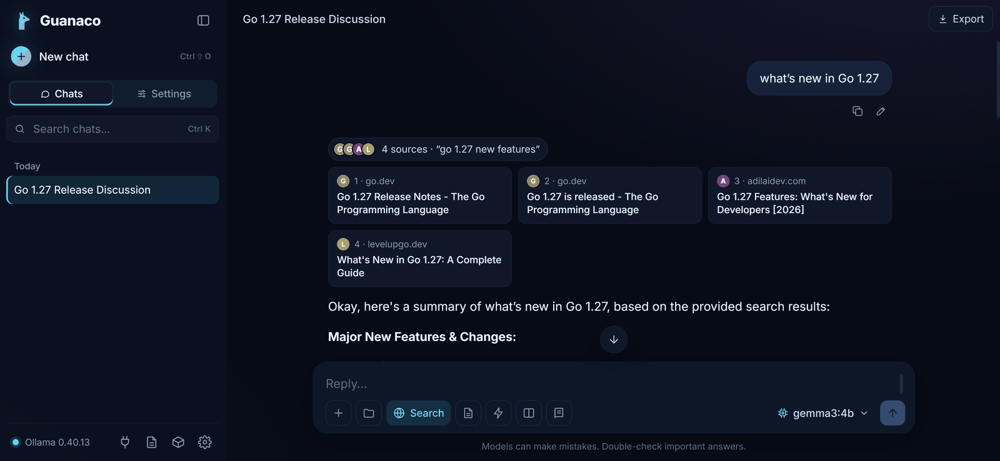
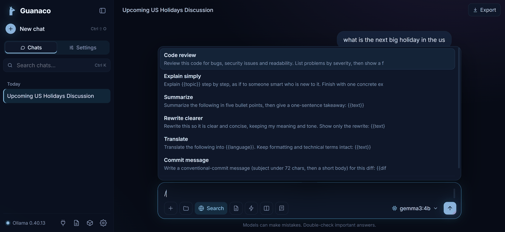
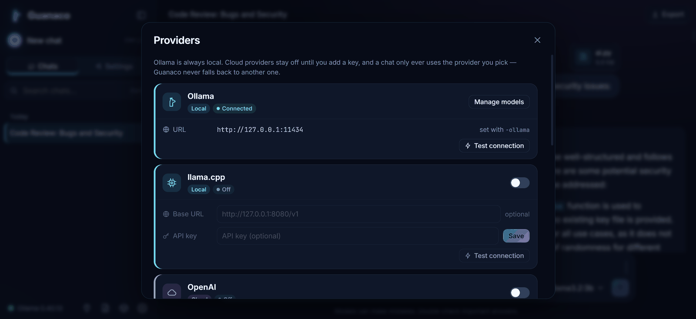

<p align="center">
  
</p>

<h1 align="center">Guanaco</h1>

<p align="center">
  <b>Local AI. On your terms.</b><br>
  Private, self-hosted AI chat for Ollama, llama.cpp & cloud models. One lightweight binary. No Docker or account required.
</p>

<p align="center">
  
</p>

---

Guanaco runs on your own computer and opens in your browser. No Docker, no
Node, no database, no account. It talks to [Ollama](https://ollama.com) and
[llama.cpp](https://github.com/ggml-org/llama.cpp) on your machine, and
optionally to OpenAI, Anthropic, Google Gemini or any OpenAI-compatible
endpoint. Everything it stores stays in a folder you control.

> **Status:** pre-1.0 and under active development. Expect changes; back up
> your data folder before upgrading.

| Platform | Status |
|---|---|
| Windows | Primary development platform |
| Linux | Supported |
| macOS | Builds and unit-tests in CI; not hand-tested yet |

## Features

- **Chat** with streaming, Markdown and code highlighting, stop/regenerate, and
  per-chat system prompts.
- **Any provider, side by side.** Ollama, llama.cpp, OpenAI, Anthropic, Gemini
  and custom OpenAI-compatible servers. One failing provider never blocks the others.
- **Compare** two models on the same prompt, then pick the better answer.
- **Branching.** Edit an earlier message or regenerate and flip between versions
  without losing the others; fork any point into a new chat.
- **Assistant profiles** (system prompt + model + temperature) and a **prompt
  library** with `{{variables}}`, opened by typing `/`.
- **Documents (local RAG).** Add text, Markdown or code files, or a whole folder
  (secrets and binaries are skipped; PDFs aren't supported yet). Passages are
  retrieved with a local embedding model and cited as `[D1]`, `[D2]`…
- **Tools via MCP.** Let a local model use [Model Context Protocol](https://modelcontextprotocol.io)
  servers (files, fetch, memory…). Every call needs your approval.
- **Web search** (DuckDuckGo or your own SearXNG) with inline citations.
- **Voice.** Read replies aloud with on-device voices; dictate through a local
  Whisper server.
- **Model management** for Ollama (pull, delete, see what's loaded) and
  automatic Ollama detection (it can even start `ollama serve` for you).
- **Backup & restore** to a single zip, plus Markdown, text and JSON export and JSON import.
- **Private by design.** Loopback-only, strict CSP, API keys encrypted and kept
  out of backups, no telemetry. See [SECURITY.md](SECURITY.md).

## Screenshots

| | |
|---|---|
|  |  |
| **Home.** Pick any model from any provider. | **Web search** with numbered citations. |
|  |  |
| **Prompt library**, opened by typing `/`. | **Providers.** Local by default; cloud stays off until you add a key. |

## Download

Grab the file for your system from the
[latest release](https://github.com/nrpeeee/guanaco/releases/latest), unzip it
and run `Guanaco` (`Guanaco.exe` on Windows). There's nothing to install. To
chat with local models you also need [Ollama](https://ollama.com) or llama.cpp
running.

| System | File |
|---|---|
| Windows (most PCs) | `guanaco_<version>_windows_amd64.zip` |
| Windows on ARM | `guanaco_<version>_windows_arm64.zip` |
| macOS, Apple Silicon | `guanaco_<version>_darwin_arm64.tar.gz` |
| macOS, Intel | `guanaco_<version>_darwin_amd64.tar.gz` |
| Linux | `guanaco_<version>_linux_amd64.tar.gz` (or `_arm64`) |

The binaries are built by [GitHub Actions](.github/workflows/release.yml) from
the tagged source, and `SHA256SUMS` lists their checksums. They aren't
code-signed yet, so the first launch shows a warning:

- **Windows:** SmartScreen says "Windows protected your PC". Click
  **More info → Run anyway**.
- **macOS:** right-click the app and choose **Open**, or run
  `xattr -d com.apple.quarantine Guanaco` once.

## Build from source

You need [Go](https://go.dev/dl/) 1.26 or newer. To chat with local models you
also need Ollama or llama.cpp running.

```bash
git clone https://github.com/nrpeeee/guanaco.git
cd guanaco
go build -o Guanaco ./cmd/guanaco      # Windows: -o Guanaco.exe
./Guanaco
```

Your browser opens at <http://localhost:3000>. Guanaco quits by itself when you
close its last tab (reloading is fine). With `-lan` it keeps running until you
stop it (Ctrl+C), so other people's tabs can't shut it down.

Installers that also create a desktop/app-menu shortcut:

- **Windows:** double-click `scripts\install.bat` (builds `Guanaco.exe` without a
  console window and puts a shortcut on your Desktop).
- **Linux:** `bash scripts/install.sh` (installs to `~/.local/bin` and adds a
  menu entry).

`scripts\llama-server.bat` is an example launcher for llama.cpp's `llama-server`
plus Guanaco on Windows; edit the settings at the top before using it.

## Options

| Flag | Default | Meaning |
|---|---|---|
| `-port` | `3000` | Port to listen on (tries the next few if it's busy). |
| `-ollama` | `http://127.0.0.1:11434` | Ollama URL. `OLLAMA_HOST` is honoured. An explicit value disables auto-detection. |
| `-data` | per-user folder (see below) | Where chats, settings and documents are stored. |
| `-no-browser` | off | Don't open a browser tab on start. |
| `-lan` | off | Listen on all interfaces. **No authentication.** Cloud providers and tools are disabled. |
| `-lan-cloud` | off | With `-lan`, also allow cloud providers (anyone on your network can then spend your API credits). |
| `-version` | | Print the version and exit. |

API keys can be typed into **Providers** in the app or supplied through the
usual environment variables (`OPENAI_API_KEY`, `ANTHROPIC_API_KEY`,
`GEMINI_API_KEY` / `GOOGLE_API_KEY`).

## Your data

| What | Where |
|---|---|
| Chats, settings, provider list, documents, tool-server list | the data folder, as plain JSON files: `%LocalAppData%\Guanaco` on Windows, `~/.local/share/guanaco` on Linux, `~/Library/Application Support/Guanaco/data` on macOS. If a `data` folder already exists next to the executable it is used instead (portable mode), and `-data` overrides both. |
| API keys | `credentials.enc` in the data folder, encrypted: **Windows DPAPI** on Windows (tied to your account); **AES-256-GCM** elsewhere, with the key in your OS config folder (`~/.config/Guanaco/credentials.key` on Linux) |
| Log | `guanaco.log` in the data folder |

Backups never contain API keys, and restoring a backup never switches on a
paid cloud provider by itself.

## Project layout

```
cmd/guanaco/   the Go program: HTTP API, providers, RAG, MCP client, storage
web/           the browser UI, embedded into the binary
  js/          native ES modules, one per feature (no bundler, no build step)
  vendor/      marked, DOMPurify, highlight.js and fonts (see THIRD_PARTY_NOTICES.md)
scripts/       installers
assets/        icons
docs/          architecture notes
```

More in [docs/ARCHITECTURE.md](docs/ARCHITECTURE.md).

## Development

```bash
go vet ./...
go test ./...                   # backend + a check that every UI module resolves
go build ./cmd/guanaco
```

The UI needs no build step: edit files under `web/js/` and `web/style.css`,
rebuild, and reload. Pull requests that keep the project dependency-free are
very welcome.

## License

[MIT](LICENSE). Bundled third-party components keep their own licenses; see
[THIRD_PARTY_NOTICES.md](THIRD_PARTY_NOTICES.md).
